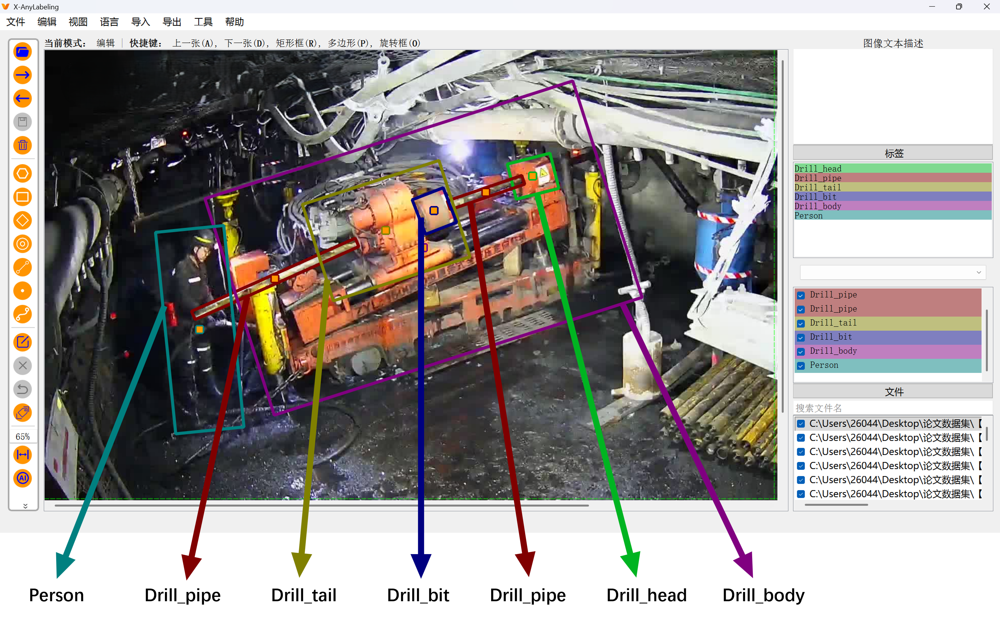
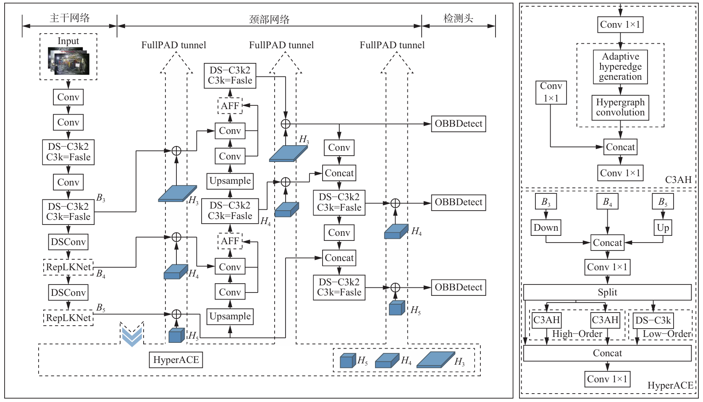
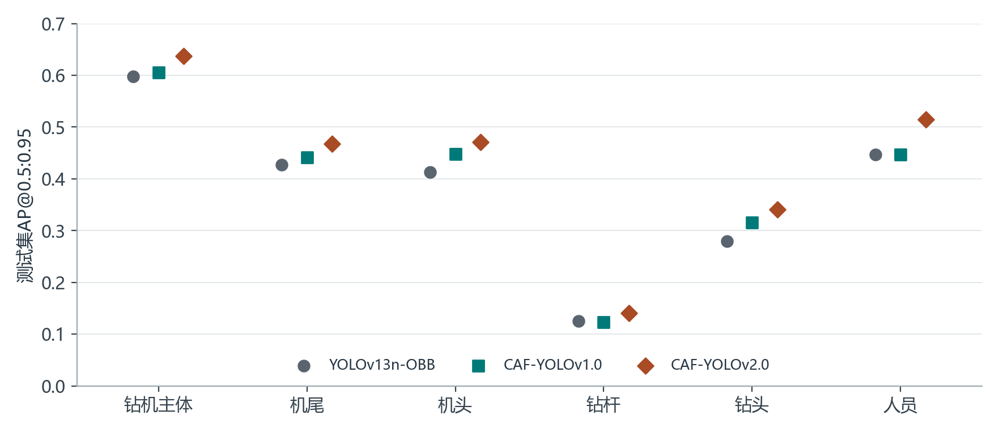
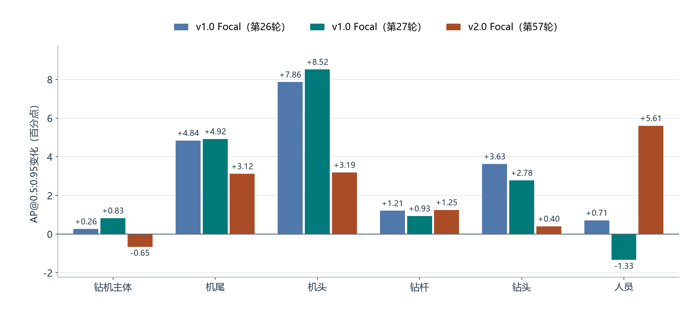
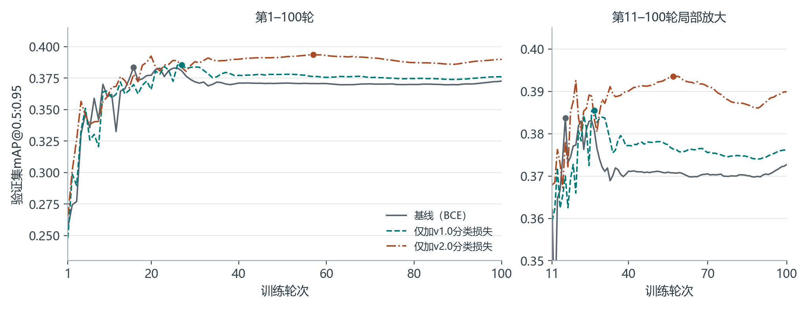

# 煤矿井下打钻作业多目标旋转检测改进：基线选型与模型改进

煤矿井下打钻场景中的多目标旋转检测研究相对较少。我们将这一阶段的数据集构建、基线模型选择和模型改进实验整理成文，供开展同类研究的同行参考。

## 研究背景

井下打钻现场光照不均，设备表面反光，目标容易与杂乱的背景混在一起。钻杆、钻机尾部等目标形态细长，作业时会发生倾斜、遮挡和交叠。用水平框（HBB）标注一根倾斜的钻杆，框内往往会包含较多背景，也无法直接表示钻杆的朝向。旋转框（OBB）可以沿目标方向标注，在给出位置和尺度的同时保留朝向信息。这些信息也是后续判别打钻工序、统计钻杆数量的依据。

2025年12月，我们与山西晋城某公司所属的两处煤矿开展合作，研究井下打钻作业识别。此前，我们研制的井下算法分站主要使用YOLOv8n-OBB和YOLOv11n-HBB，分别用于旋转框和水平框检测。现场作业中，钻杆姿态会变化，作业人员有时也会调整摄像头。即使钻机仍在原位，机头、机尾和钻杆在画面中的方向与相对位置也可能改变。因此，我们决定采用旋转框识别作业目标，为工序判别和计数保留所需的几何信息。

我们先对YOLOv12做了改进和测试。更换数据集或井下摄像头后，模型表现波动较大。结合当时已有的代码和现场部署条件，我们随后将研究重点转向YOLOv13的旋转检测版本。

## 第一阶段　数据集构建与基线模型选择

### 1.1 视频来源与目标标注

视频来自两处煤矿的“一钻一视频”监控系统历史录像。由于煤矿井下摄像头种类较多并且2026年仅有部分同种类摄像头在运行，只采用2026年数据泛化性差，我们又想提升模型泛用性，补充一些其余摄像头等标准的数据，故最终选取了80段来自2024年8月-12月的视频数据与120段来自2026年1月-2月的视频数据（后续补充3月份2段视频数据进行独立测试视频，不进入数据集）

我们用自研程序对长视频抽帧并剔除重复帧，共得到近10万张图像。受标注人力限制，我们从其中157段作业视频中选取约4万张图像标注。考虑到后续还要开展工序判别和人员近距风险预警，共设置六类目标，分别为钻机主体（`Drill_body`）、钻机头部（`Drill_head`）、钻机尾部（`Drill_tail`）、钻杆（`Drill_pipe`）、钻头（`Drill_bit`）和人员（`Person`）。下图为标注示例图。

**图1 数据集标注示例**

最终获得约3.3万张有效标注图像，构成我们建立的首套煤矿井下钻机作业多类别旋转目标数据集（Underground Coal Mine Drilling Operation Multi-Class OBB Dataset，UCMDO-OBB）。感谢矿山智能团队参与数据标注的各位成员。

受合作煤矿生产资料保密要求限制，我们无法公开UCMDO-OBB数据集中的井下作业录像、抽帧图像及配套标注。开展同类研究时，可参考本团队张富凯老师等人在《Scientific Data》发表的CMDPC_OBB数据集。其中，多目标检测子集MOD_2D提供了钻机主体、钻机头部、钻机尾部和钻杆四类目标的旋转框标注。公开前，本研究团队已对含有人员的画面进行筛除或匿名化处理。[论文原文](https://www.nature.com/articles/s41597-026-07474-y)

### 1.2 候选模型与实验设置

我们按照惯例将数据集划分为训练集、验证集和测试集，占比分别约为70%、10%和20%。水平框检测与旋转框检测使用相同的图像和数据划分，水平框（HBB）标签由旋转框（OBB）标注转换得到。我们从团队维护的煤矿目标检测模型库中选取表1所列的候选模型，开展四轮训练与测试。各轮沿用同一数据划分，并分别使用不同的随机种子。YOLO系列模型的输入图像尺寸统一设为640×640像素，批大小（batch size）为32，初始学习率为0.001，训练轮数设为300。前两轮实验在配备4张NVIDIA RTX 3080 Ti的云服务器上完成，后两轮在配备NVIDIA RTX A6000的本地服务器上完成。

**表1 初筛候选模型**

| 类别 | 候选模型 | 配置数 |
|---|---|---:|
| YOLO系列和RTMDet-R | YOLOv5、YOLOv6、YOLOv7、YOLOv8、YOLOv9、YOLOv10、YOLOv11、YOLOv12、YOLOv13、RTMDet-R | 18 |
| 两阶段旋转检测 | Rotated Faster R-CNN、RoI Transformer、Gliding Vertex、SCRDet、SCRDet++、CAD-Net、Oriented R-CNN、ReDet、AOPG | 9 |
| 有锚框单阶段检测 | R-RetinaNet、RSDet、S2A-Net、R3Det、DAL | 5 |
| 无锚框单阶段检测 | P-RSDet、DRN、BBAVectors、O2-DNet、CenterMap-Net、Oriented RepPoints、CFA | 7 |
| DETR系列 | Oriented DETR、AO2-DETR、ARS-DETR、D2Q-DETR、Rotated RT-DETR | 5 |
| 弱监督旋转检测 | PointOBB、H2RBox、H2RBox-v2、P2RBox | 4 |
| **合计** | **40个模型名称，HBB与OBB分别计数** | **48** |

首行中，YOLOv10只测HBB，RTMDet-R只测OBB，其余YOLO版本均列入HBB和OBB两种配置。部分模型受云服务器内存和实现适配的限制，约有5项未能成功运行。由于早期实验记录未能完整保留，实际取得完整结果的配置数已无法找到。感谢协助完成这批实验的老师和研究生同学。

### 1.3 九种模型的对比结果

我们在整理四轮正式结果时注意到，第二轮中有九种模型的表现呈现出较清楚的趋势。按[mAP@0.5](mailto:mAP@0.5):0.95从低到高排列时，这九种模型的[mAP@0.5](mailto:mAP@0.5)也依次提高，精确率和召回率总体上随之提高，个别模型的名次有所交叉。正是观察到这一现象，我们才从众多候选模型中选取这九种，进一步比较它们的检测精度和推理耗时。表中呈现的规律也与这一选取过程有关。其余三轮中，这九种模型的整体趋势相近，但具体排序均与第二轮略有不同，名次变化主要出现在YOLO的HBB和OBB版本之间，我们当时考虑，水平框由旋转框转换、井下图像噪声较大，以及部分姿态和遮挡场景样本有限，都可能影响实验结果，当时未逐项验证。因此，表2保留了第二轮的结果。

表2保留了第二轮结果，精确率（P）、召回率（R）及两项mAP均以0至1表示。这一轮中，两项mAP的模型排序一致。三种两阶段模型的两项mAP均高于六种轻量YOLO，但并非每项指标都按同一次序递增。例如，YOLOv13n-OBB的召回率为0.674，高于Rotated Faster R-CNN的0.653。其余三轮的排序与第二轮略有不同。

**表2 九种基线模型的检测结果（第二轮）**

| 模型 | 精确率 | 召回率 | mAP@0.5 | mAP@0.5:0.95 | 参数量/10⁶个 | GFLOPs | 平均单帧推理时间/ms |
|---|---:|---:|---:|---:|---:|---:|---:|
| YOLOv5n-OBB | 0.848 | 0.595 | 0.684 | 0.401 | 2.0 | 4.9 | 8.73 |
| YOLOv8n-OBB | 0.867 | 0.627 | 0.718 | 0.438 | 3.1 | 8.3 | 10.57 |
| YOLOv10n | 0.859 | 0.618 | 0.709 | 0.426 | 2.3 | 6.5 | 10.14 |
| YOLOv11n | 0.872 | 0.645 | 0.732 | 0.447 | 3.0 | 8.5 | 10.80 |
| YOLOv12n | 0.878 | 0.655 | 0.739 | 0.454 | 2.3 | 6.3 | 9.93 |
| YOLOv13n-OBB | 0.887 | 0.674 | 0.751 | 0.481 | 3.1 | 8.3 | 10.87 |
| Rotated Faster R-CNN | 0.894 | 0.653 | 0.758 | 0.487 | 41.0 | 180.0 | 19.37 |
| Oriented R-CNN | 0.899 | 0.662 | 0.767 | 0.499 | 45.0 | 192.0 | 22.56 |
| ReDet | 0.903 | 0.681 | 0.777 | 0.509 | 35.0 | 165.0 | 33.71 |

2026年6月我们投入实地使用时，我们对之前的结果开展了复盘，经过思考与复盘觉得这组数据与我们的数据集有关系，数据集在采集的时候由于2s内煤矿钻机变化并不大，然后就是我们的去除重复帧算法由于煤矿井下光线较差，摄像头画面易出现扰动，导致很多数据集图片区别不太大，看起来为较为连续的数据集，在数据集分割时虽然做了处理，但是依旧存在一定的与测试集类似的照片进入训练集，导致最终数据结果较为平滑，这也为我们后续进行煤矿井下数据集的构造提供了一些经验与教训（抽帧与去除重复帧要进行单独的特殊的处理），非常遗憾，由于数据已经很久没有使用，原始处理好的数据集随着云端服务器忘记续费与本地服务器他人使用后清理而导致丢失，虽然后续从个别同学电脑中找回了一部分，但是依旧无法还原原本数据，故无法进行数据集里面可能存在的这一问题的测试。后续数据集构建与处理要对煤矿打钻视频除重复帧要进行特殊处理与数据双备份。

在四轮测试中，YOLOv13n-OBB在轻量YOLO模型中保持了较好的检测精度。YOLOv13n-OBB的平均单帧推理时间为10.87 ms，低于三种两阶段模型。获得了基线数据我们接下来着手进行模型的改进，井下算法分站此前已有YOLO模型的部署经验，现有训练和推理代码也便于开展模块对比。综合这些因素，我们选择YOLOv13n-OBB作为后续改进的基线。

## 第二阶段　YOLOv13n-OBB的改进与验证

2026年2月，第一轮YOLO系列模型测试结束后，我们就已经开始改进YOLOv13n-OBB。前期由负责模块开发的同学从团队已有的模块库中选取候选方案，逐项接入基线网络进行测试。YOLOv13的跨层连接较多，修改骨干网络后，还需要核对相应特征能否在后续融合层正确衔接。部分方案在一组图像上有所改善，更换井下场景后却难以保持。

经过多次比较，我们保留了表现相对稳定的三项改动。RepLKNet的大核卷积用于骨干网络的特征提取，AFF用于融合不同层级的特征，Focal Loss用于调整不同难度样本对分类损失的贡献。随后，我们又调整了大核模块的接入位置、特征融合方式和分类损失的实现。下面两组实验分别记录早期结构改动和后续分类损失调整的结果。

### 2.1 四类别数据集上的结构改进实验

我们从早期数据集（2024年左右的数据构成的数据集）中单独取出一套4,880张图像的四类别OBB数据集，标注对象为钻机主体、钻机头部、钻机尾部和钻杆。本组实验基于本地修改的Ultralytics 8.3.63，以640 × 640图像、批大小32从头训练100轮。各模型按验证集表现选择权重，再在独立测试集的488张图像、1,605个目标上评测。

这一版main-YOLO以YOLOv13n-OBB为基础，在骨干网络中引入RepLK大核卷积，在跨层连接处使用AFF，分类损失仍用二元交叉熵（BCE），但并为对具体内部连接做优化（后续CAF-YOLO为优化过内部实现的具体连接版本）。表3和表4列出其中四种模型的独立测试成绩和训练记录。

**表3 四类别独立测试集上的检测结果**

| 模型 | 精确率（%） | 召回率（%） | mAP@0.5 | mAP@0.5:0.95 |
|---|---:|---:|---:|---:|
| YOLOv11n-OBB | 68.1821 | 30.9079 | 0.3411 | 0.2470 |
| YOLOv12n-OBB | 62.2275 | 36.5973 | 0.4369 | 0.2546 |
| YOLOv13n-OBB | 73.7375 | 33.0158 | 0.4207 | 0.3361 |
| main-YOLO | 94.6326 | 41.1835 | 0.4566 | 0.3119 |

相较于同组YOLOv13n-OBB，main-YOLO的精确率、召回率和mAP@0.5分别提高20.90、8.17和3.59个百分点，mAP@0.5:0.95下降2.42个百分点。

**表4 四类别实验的验证记录**

| 模型 | 完成轮数 | 验证mAP@0.5:0.95首次最优轮次 | 最优验证值 |
|---|---:|---:|---:|
| YOLOv11n-OBB-adapted | 100 | 18 | 0.10327 |
| YOLOv12n-OBB-adapted | 100 | 15 | 0.12777 |
| YOLOv13n-OBB | 100 | 37 | 0.08857 |
| main-YOLO | 100 | 14 | 0.12163 |

“首次最优轮次”取训练日志`results.csv`中验证mAP@0.5:0.95首次达到最大记录值的轮次。日志只保留有限小数位，因此显示值相同的轮次，在舍入前可能略有差异。

### 2.3 六类别数据集上的结构改进实验

#### 2.3.1 固定机位连续视频子集评测

井下钻机移动缓慢，一台钻机可在同一地点连续作业数月。固定机位拍摄时，相邻画面中的背景和钻机姿态变化较小。若将同一段录像的相邻帧分别划入训练集和测试集，两个集合中就容易出现高度相似的画面。考虑到现场实时识别面对的正是这类连续画面，我们选取了一个完整时段的作业录像，每2秒抽取1帧，保留其中的相似帧，以考察模型在连续作业场景下的识别表现。

Fullmain-YOLO以main-YOLO为基础，保留原有的大核卷积和特征融合结构，针对不同类别调整了分类损失。其中，钻机主体和人员沿用BCE，钻杆、机头、钻头和机尾引入Focal调制，并对机尾负样本采用较低的调制比例。

**表5 固定机位视频子集上的检测结果**

| 模型 | 精确率（%） | 召回率（%） | mAP@0.5 | mAP@0.5:0.95 |
|---|---:|---:|---:|---:|
| YOLOv5n-OBB | 91.24 | 81.43 | 0.86483 | 0.64021 |
| YOLOv10n-HBB | 92.14 | 81.52 | 0.87619 | 0.67237 |
| YOLOv8n-OBB | 92.15 | 82.93 | 0.88132 | 0.66613 |
| YOLOv11n-HBB | 93.04 | 83.16 | 0.88148 | 0.67876 |
| YOLOv12n-HBB | 93.06 | 83.25 | 0.88351 | 0.67941 |
| YOLOv13n-OBB | 94.28 | 84.79 | 0.90019 | 0.73489 |
| Fullmain-YOLO | 94.81 | 86.18 | 0.91263 | 0.75888 |

其中，Fullmain-YOLO相较于YOLOv13n-OBB，精确率提高0.53个百分点，召回率提高1.39个百分点，mAP@0.5和mAP@0.5:0.95分别提高1.24和2.40个百分点。

#### 2.3.2 原版CAF-YOLO在UCMDO-OBB上的实验结果

原版CAF-YOLO在早上述UCMDO-OBB数据集上的结果见下列表6至表9。模型横评表沿用原表的0至1数值。逐类表中的差值均为引入Focal Loss后的AP减去引入前的AP。

**表6 原版CAF-YOLO在UCMDO-OBB数据集上的消融实验结果**

| RepLKNet | AFF  | Focal Loss | 精确率/% | 召回率/% | mAP@0.5 | mAP@0.5:0.95 | 参数量/10⁶个 | GFLOPs | 平均单帧推理时间/ms | 帧率/(帧·s⁻¹) |
| -------- | ---- | ---------- | -------: | -------: | ------: | -----------: | -----------: | -----: | ------------------: | ------------: |
| ×        | ×    | ×          |     88.7 |     67.4 |   0.751 |        0.481 |         3.10 |   8.30 |               10.87 |            92 |
| √        | ×    | ×          |     89.1 |     69.8 |   0.766 |        0.494 |         3.25 |   8.70 |               11.36 |            88 |
| ×        | √    | ×          |     89.8 |     68.1 |   0.764 |        0.493 |         3.18 |   8.45 |               11.11 |            90 |
| ×        | ×    | √          |     88.6 |     68.6 |   0.758 |        0.490 |         3.10 |   8.30 |               10.87 |            92 |
| √        | √    | ×          |     90.2 |     70.4 |   0.777 |        0.507 |         3.33 |   8.84 |               11.63 |            86 |
| √        | ×    | √          |     89.2 |     71.0 |   0.773 |        0.503 |         3.26 |   8.72 |               11.36 |            88 |
| ×        | √    | √          |     89.9 |     69.1 |   0.770 |        0.500 |         3.19 |   8.46 |               11.11 |            90 |
| √        | √    | √          |     90.5 |     71.7 |   0.783 |        0.514 |         3.35 |   8.83 |               11.63 |            86 |

**表7 引入原版Focal Loss前后YOLOv13n-OBB的六类检测精度**

| 类别         | 引入Focal Loss前 AP@0.5:0.95 | 引入Focal Loss后 AP@0.5:0.95 |  差值 |
| ------------ | ------------------------------: | ------------------------------: | ----: |
| Drill_body   |                           0.547 |                           0.551 | 0.004 |
| Drill_tail   |                           0.505 |                           0.510 | 0.005 |
| Drill_head   |                           0.517 |                           0.525 | 0.008 |
| Drill_pipe   |                           0.449 |                           0.461 | 0.012 |
| Drill_bit    |                           0.394 |                           0.409 | 0.015 |
| Person       |                           0.474 |                           0.481 | 0.007 |
| mAP@0.5:0.95 |                           0.481 |                           0.490 | 0.009 |

**表8 引入原版Focal Loss前后YOLOv13n-OBB的收敛性能**

| 损失设置         | 最优mAP@0.5:0.95 | 最优轮次 | 最终mAP@0.5:0.95 | 最终损失 | 收敛轮次E90% |
| ---------------- | ---------------: | -------: | ---------------: | -------: | ----------------------: |
| 引入Focal Loss前 |            0.489 |      223 |            0.481 |    0.111 |                     148 |
| 引入Focal Loss后 |            0.498 |      207 |            0.490 |    0.106 |                     126 |

注：E90%为验证集mAP@0.5:0.95首次达到该设置自身最优值90%的轮次。原版实验中，单独引入Focal Loss后六类AP均提高，钻头增幅最大（0.015）；最优轮次由第223轮提前至第207轮，E90%由148轮提前至126轮。

**表9　UCMDO-OBB数据集上不同模型的对比实验结果（前九个模型结果即为前文所述第二轮实验结果）**

| 模型                 | 精确率 | 召回率 | mAP@0.5 | mAP@0.5:0.95 | 参数量/10⁶个 | GFLOPs | 平均单帧推理时间/ms |
| -------------------- | -----: | -----: | ------: | -----------: | -----------: | -----: | ------------------: |
| YOLOv5n-OBB          |  0.848 |  0.595 |   0.684 |        0.401 |          2.0 |    4.9 |                8.73 |
| YOLOv8n-OBB          |  0.867 |  0.627 |   0.718 |        0.438 |          3.1 |    8.3 |               10.57 |
| YOLOv10n             |  0.859 |  0.618 |   0.709 |        0.426 |          2.3 |    6.5 |               10.14 |
| YOLOv11n             |  0.872 |  0.645 |   0.732 |        0.447 |          3.0 |    8.5 |               10.80 |
| YOLOv12n             |  0.878 |  0.655 |   0.739 |        0.454 |          2.3 |    6.3 |                9.93 |
| YOLOv13n-OBB         |  0.887 |  0.674 |   0.751 |        0.481 |          3.1 |    8.3 |               10.87 |
| Rotated Faster R-CNN |  0.894 |  0.653 |   0.758 |        0.487 |         41.0 |  180.0 |               19.37 |
| Oriented R-CNN       |  0.899 |  0.662 |   0.767 |        0.499 |         45.0 |  192.0 |               22.56 |
| ReDet                |  0.903 |  0.681 |   0.777 |        0.509 |         35.0 |  165.0 |               33.71 |
| CAF-YOLO             |  0.905 |  0.717 |   0.783 |        0.514 |         3.35 |    8.8 |               11.63 |

原版CAF-YOLO在表9中的精确率为0.905，召回率为0.717，mAP@0.5和mAP@0.5:0.95分别为0.783和0.514。相较于同表YOLOv13n-OBB，四项指标分别提高1.8、4.3、3.2和3.3个百分点，平均单帧推理时间由10.87ms增至11.63ms。

#### 2.3.3 面向井下现场应用的CAF-YOLO模型重建与复测

2026年9月至11月，为落实煤矿现场的打钻作业识别的实地需求，我们重新整理了早期实验资料。原版CAF-YOLO的完整模型文件未能找回，但我们依据留存的历史文档和零散配置恢复了其模型结构、补全实现，得到**CAF-YOLOv1.0**和**CAF-YOLOv2.0**两个后续版本（当时大概率的实现就是目前v2.0这一版，但是由于时间过去半年已经无法核对，严谨起见重新命名为v1.0与v2.0）。以下结果来自两版模型在重新整理的六类别数据集上的训练与评测，各项增减均与同一数据划分下的对照组比较。

此次复测的数据集构建吸取了之前的教训，完善了数据集的分差融合与防泄漏，对数据采集的方式以及间隔防重复进行了修改与测试，同时合并剔除了过度重复图像，标注后再次对图像与标注进行了核对，并将存在坐标越界或标注冲突等问题的图像单独处理完善。最终保留20929张图像，其中14650张用于训练、4186张用于验证、2093张用于测试，分别含93390、25843和13330个标注目标。已有14186张图像沿用既定划分，新增6743张图像按来源片段整组划分，以减少同一新增片段的相邻帧跨集合出现。重新整理的数据按双备份方式保存，并随数据保留图像划分清单、标注文件和校验记录。

**图2 CAF-YOLO网络结构**

上图为CAF-YOLOv1.0和v2.0的总体结构示意图，在骨干P4、P5引入大核卷积，在颈部两处进行AFF融合，并通过HyperACE及FullPAD通路连接多尺度特征，输出三个尺度的旋转框预测。两版的大核分支、融合方式及训练时的Focal分类损失见下表。

**四种模型的大核卷积、特征融合与分类损失**

四种模型均采用P3、P4、P5三个尺度的旋转检测头。下表中，✓表示启用该项改进，×表示未启用。Focal一栏仅指分类损失。

| 模型          | 大核卷积（RepLK）                                            | 跨尺度特征融合（AFF）                                        | Focal分类损失                                                |
| ------------- | ------------------------------------------------------------ | ------------------------------------------------------------ | ------------------------------------------------------------ |
| main-YOLO     | ✓　骨干P4、P5分别采用27×27和13×13大核。                      | ✓　在颈部两处对齐不同尺度的特征，利用局部和全局通道注意力对两路特征加权求和。 | ×　六类目标均使用二元交叉熵（BCE）。                         |
| Fullmain-YOLO | ✓　沿用main-YOLO的大核结构。                                 | ✓　沿用main-YOLO的两处AFF融合。                              | ✓　钻杆、机头、钻头和机尾引入Focal调制，钻机主体和人员沿用BCE。机尾负样本的调制比例为0.25，其余三个启用类别为0.5。 |
| CAF-YOLOv1.0  | ✓　保留原骨干，在P4、P5分别增加27×27和13×13大核残差分支。门控系数从零开始学习。 | ✓　保留两路特征的通道拼接，对各通道施加有界权重。            | ✓　正样本软标签沿用BCE；负样本按特征层和类别在同批次内重新加权，调制指数为1，强度为0.125。 |
| CAF-YOLOv2.0  | ✓　先压缩通道，再在P4、P5分别将25×25、9×9大核与3×3分支并联，最后投影回原通道并作残差相加。 | ✓　P4调节通道增益；P3另外提取水平、垂直和两条对角线方向的特征。 | ✓　正样本软标签沿用BCE；在每张图像内，按特征层、类别及前景或背景位置对目标分数为零的分类项分组，组内有效样本较少时减弱调制。 |

main-YOLO到Fullmain-YOLO的改动集中在分类损失。CAF-YOLOv1.0进一步改变了大核特征接入骨干的方式，并保留两路特征供融合后的卷积使用。CAF-YOLOv2.0则针对钻杆等细长目标的朝向变化，在分辨率较高的P3融合节点引入方向信息，同时将负样本调制细化到单张图像。

为便于比较，后续实验各模型使用相同的训练集、验证集和测试集，输入尺寸统一为640×640像素。六种YOLO基线与两版CAF-YOLO均在全训练集上训练100轮。两版CAF-YOLO使用已有的YOLOv13权重初始化对应网络层，批大小为32，随机种子为42。两版模型均采用AdamW优化器，初始学习率为0.001，权重衰减为0.0005。前3轮预热，随后按余弦日程调整学习率，最后10轮关闭Mosaic增强。训练采用混合精度，并依据验证集表现选取权重，用于正式验证和测试。

三种两阶段旋转检测模型采用统一的6轮训练日程。Rotated Faster R-CNN、Oriented R-CNN和ReDet均用各自的ImageNet预训练权重初始化骨干网络，批大小为2，随机种子为42，采用FP32训练。Rotated Faster R-CNN和ReDet使用SGD优化器，初始学习率为0.005。Oriented R-CNN使用AdamW优化器，初始学习率为0.0001。

HBB模型的标注由同批图像的旋转框转换得到，评测使用水平框IoU；OBB模型使用旋转框概率交并比（ProbIoU）匹配预测框和标注框。后续模型横评表的精确率、召回率与两项mAP均以0至1表示，消融表仍按百分数列出精确率和召回率。

#### 2.3.4 正式测试与验证（第一名与第二名分别用粗体与下划线展示）

**表10 重新整理的六类别测试集上不同模型的对比实验结果**

| 模型                 |              精确率 |              召回率 |             mAP@0.5 |        mAP@0.5:0.95 | 参数量/10⁶个 |  GFLOPs |
| -------------------- | ------------------: | ------------------: | ------------------: | ------------------: | -----------: | ------: |
| YOLOv5n-OBB          |            0.753121 |            0.539010 |            0.603466 |            0.339032 |        2.016 |   5.019 |
| YOLOv8n-OBB          |            0.797297 |            0.617538 |            0.697307 | <ins>0.413086</ins> |        3.084 |   8.445 |
| YOLOv10n-HBB         |            0.765996 |            0.538770 |            0.555560 |            0.241563 |        2.278 |   6.732 |
| YOLOv11n-HBB         |            0.752976 |            0.516095 |            0.585268 |            0.259346 |        3.049 |   8.468 |
| YOLOv12n-HBB         |            0.737770 |            0.508874 |            0.560680 |            0.237308 |        2.324 |   6.329 |
| *YOLOv13n-OBB*       | <ins>0.820030</ins> |            0.620662 |            0.666211 |            0.381713 |        3.100 |   8.263 |
| Rotated Faster R-CNN |            0.763597 |        **0.707573** |        **0.727022** |            0.409409 |       41.354 | 182.154 |
| Oriented R-CNN       |            0.813007 |            0.627808 |            0.690819 |            0.394714 |       44.754 | 186.696 |
| ReDet                |            0.727158 |            0.605304 |            0.651939 |            0.364984 |       35.419 | 164.554 |
| *CAF-YOLOv1.0*       |            0.813488 |            0.632955 |            0.689055 |            0.396952 |        3.350 |   8.941 |
| *CAF-YOLOv2.0*       |        **0.835842** | <ins>0.650585</ins> | <ins>0.715524</ins> |        **0.428691** |        3.350 |   8.834 |

按表中六种YOLO基线的顺序，验证集选出的best权重分别为第34、27、22、74、37、16轮。CAF-YOLOv1.0和CAF-YOLOv2.0分别选中第19轮和第44轮.

与同表YOLOv13n-OBB相比，v1.0的召回率和两项mAP提高，精确率下降0.65个百分点。v2.0的四项指标均提高，mAP@0.5:0.95从0.381713升至0.428691。与v1.0相比，v2.0的精确率、召回率及两项mAP分别提高2.24、1.76、2.65和3.17个百分点。在该数据集各自的训练日程下，Rotated Faster R-CNN的召回率和mAP@0.5虽高于v2.0，但mAP@0.5:0.95低于v2.0，且v2.0对于实时检测更加占优势，轻量YOLO更适合对实时性要求较高的井下视频检测。

**表11 YOLOv13n-OBB基线与两版CAF-YOLO在测试集上的逐类精度（均启用三个模块）**

| 类别         | YOLOv13n-OBB AP@0.5:0.95 | CAF-YOLOv1.0 AP@0.5:0.95 | CAF-YOLOv2.0 AP@0.5:0.95 | 差值（v2.0−v1.0） |
| ------------ | --------------------------: | --------------------------: | --------------------------: | ----------------: |
| Drill_body   |                    0.597445 |         <ins>0.605275</ins> |                **0.636913** |         +0.031638 |
| Drill_tail   |                    0.427169 |         <ins>0.441799</ins> |                **0.467962** |         +0.026163 |
| Drill_head   |                    0.413135 |         <ins>0.448548</ins> |                **0.471244** |         +0.022696 |
| Drill_pipe   |         <ins>0.125812</ins> |                    0.123185 |                **0.140776** |         +0.017591 |
| Drill_bit    |                    0.279319 |         <ins>0.316115</ins> |                **0.341018** |         +0.024903 |
| Person       |         <ins>0.447395</ins> |                    0.446789 |                **0.514235** |         +0.067446 |
| mAP@0.5:0.95 |                    0.381713 |         <ins>0.396952</ins> |                **0.428691** |         +0.031740 |

**图3 基线及两版完整模型在六类目标上的测试AP@0.5:0.95**

在同一测试集上，CAF-YOLOv1.0有四类AP高于YOLOv13n-OBB基线，钻杆和人员两类略低。CAF-YOLOv2.0在六类上均列第一，相较v1.0提升最大的是人员，AP由0.446789升至0.514235。钻杆仍是三个模型中各自AP最低的类别。

#### 2.3.5 CAF-YOLOv1.0与CAF-YOLOv2.0的消融实验

两个版本均以YOLOv13n-OBB为基线，分别切换各自的大核卷积、AFF及Focal Loss。关闭Focal Loss时采用BCE。√ 表示启用，× 表示关闭。

**表12 CAF-YOLOv1.0在六类别测试集上的消融实验结果（由于跑到一半我们找到了v2.0的文件，顾没有继续跑剩余的消融实验了）**

| RepLKNet | AFF  | Focal Loss |          精确率/% |          召回率/% |             mAP@0.5 |        mAP@0.5:0.95 | 参数量/10⁶个 | GFLOPs |
| -------- | ---- | ---------- | ----------------: | ----------------: | ------------------: | ------------------: | -----------: | -----: |
| ×        | ×    | ×          |        **82.003** |            62.066 |            0.666211 |            0.381713 |        3.100 |  8.263 |
| ×        | ×    | √          |            79.908 |        **63.594** | <ins>0.688184</ins> |        **0.409470** |        3.100 |  8.263 |
| √        | √    | ×          |            79.801 |            62.915 |            0.672753 |            0.393808 |        3.350 |  8.941 |
| √        | √    | √          | <ins>81.349</ins> | <ins>63.295</ins> |        **0.689055** | <ins>0.396952</ins> |        3.350 |  8.941 |

四组均完成100轮训练。在大核卷积和AFF均启用时，加入Focal后精确率、召回率、mAP@0.5和mAP@0.5:0.95分别提高1.55、0.38、1.63和0.31个百分点。四组中，mAP@0.5:0.95最高的是仅加Focal组（0.409470）。

**表13 CAF-YOLOv2.0在重新整理的六类别数据集上的消融实验结果（完整消融）**

| RepLKNet | AFF  | Focal Loss |          精确率/% |          召回率/% |             mAP@0.5 |        mAP@0.5:0.95 | 参数量/10⁶个 | GFLOPs |
| -------- | ---- | ---------- | ----------------: | ----------------: | ------------------: | ------------------: | -----------: | -----: |
| ×        | ×    | ×          |            82.003 |            62.066 |            0.666211 |            0.381713 |        3.100 |  8.263 |
| √        | ×    | ×          |            82.164 |            58.821 |            0.669926 |            0.398790 |        3.259 |  8.680 |
| ×        | √    | ×          |            79.771 |            60.412 |            0.680994 |            0.398964 |        3.190 |  8.417 |
| ×        | ×    | √          |            83.398 |            60.590 |            0.678698 |            0.403240 |        3.100 |  8.263 |
| √        | √    | ×          |            82.762 | <ins>63.380</ins> | <ins>0.694760</ins> | <ins>0.406759</ins> |        3.350 |  8.834 |
| √        | ×    | √          |        **83.815** |            60.757 |            0.673365 |            0.400497 |        3.259 |  8.680 |
| ×        | √    | √          |            82.230 |            60.461 |            0.677684 |            0.391101 |        3.190 |  8.417 |
| √        | √    | √          | <ins>83.584</ins> |        **65.059** |        **0.715524** |        **0.428691** |        3.350 |  8.834 |

完整模型在八组中取得最高召回率、mAP@0.5和mAP@0.5:0.95。精确率最高的是大核卷积与Focal组合（83.815%）。仅启用AFF时，增加Focal使mAP@0.5:0.95由0.398964降至0.391101；同时启用大核卷积与AFF时，增加Focal使该指标由0.406759升至0.428691。

**表14 保留v2.0大核卷积与AFF时，引入Focal Loss前后的逐类测试精度**

| 类别         | 引入Focal Loss前 AP@0.5:0.95 | 引入Focal Loss后 AP@0.5:0.95 |      差值 |
| ------------ | ------------------------------: | ------------------------------: | --------: |
| Drill_body   |             <ins>0.597552</ins> |                    **0.636913** | +0.039361 |
| Drill_tail   |             <ins>0.428231</ins> |                    **0.467962** | +0.039731 |
| Drill_head   |             <ins>0.467317</ins> |                    **0.471244** | +0.003927 |
| Drill_pipe   |             <ins>0.139991</ins> |                    **0.140776** | +0.000785 |
| Drill_bit    |             <ins>0.318975</ins> |                    **0.341018** | +0.022043 |
| Person       |             <ins>0.488485</ins> |                    **0.514235** | +0.025750 |
| mAP@0.5:0.95 |             <ins>0.406759</ins> |                    **0.428691** | +0.021933 |

在两项结构都启用时，加入v2.0的Focal使六类测试AP均提高。机尾和钻机主体分别提高3.97和3.94个百分点，钻杆仅提高0.08个百分点。

#### 2.3.6 单独引入Focal Loss的YOLOv13n-OBB对照

三组模型均使用原有YOLOv13n-OBB骨干、融合层和检测头，仅替换分类损失，各训练100轮。主对照使用各组验证集mAP@0.5:0.95最高轮次的权重，同时补测同一次v1.0单加Focal训练中按验证综合评分选出的第26轮权重（因为我们发现验证集上面效果好的不一定测试集效果好，没有深究，就挑选了best27旁边的26进行了实验）。表15至表18按版本分别列出六类AP和收敛结果，差值为引入Focal Loss后的AP减去引入前的AP。

**表15　单独引入v1.0的Focal Loss前后YOLOv13n-OBB的六类测试精度（第27轮，验证mAP最优）**

| 类别         | 引入Focal Loss前 AP@0.5:0.95 | 引入Focal Loss后 AP@0.5:0.95 |      差值 |
| ------------ | ------------------------------: | ------------------------------: | --------: |
| Drill_body   |             <ins>0.597445</ins> |                    **0.605710** | +0.008266 |
| Drill_tail   |             <ins>0.427169</ins> |                    **0.476409** | +0.049240 |
| Drill_head   |             <ins>0.413135</ins> |                    **0.498336** | +0.085201 |
| Drill_pipe   |             <ins>0.125812</ins> |                    **0.135161** | +0.009349 |
| Drill_bit    |             <ins>0.279319</ins> |                    **0.307107** | +0.027788 |
| Person       |                    **0.447395** |             <ins>0.434096</ins> | -0.013299 |
| mAP@0.5:0.95 |             <ins>0.381713</ins> |                    **0.409470** | +0.027757 |

**表15（续）同一次训练第26轮权重的六类测试精度（验证综合评分补测）**

| 类别         | 引入Focal Loss前（基线第16轮） AP@0.5:0.95 | 引入Focal Loss后（第26轮） AP@0.5:0.95 |      差值 |
| ------------ | --------------------------------------------: | ----------------------------------------: | --------: |
| Drill_body   |                           <ins>0.597445</ins> |                              **0.600089** | +0.002644 |
| Drill_tail   |                           <ins>0.427169</ins> |                              **0.475595** | +0.048425 |
| Drill_head   |                           <ins>0.413135</ins> |                              **0.491783** | +0.078648 |
| Drill_pipe   |                           <ins>0.125812</ins> |                              **0.137880** | +0.012068 |
| Drill_bit    |                           <ins>0.279319</ins> |                              **0.315597** | +0.036278 |
| Person       |                           <ins>0.447395</ins> |                              **0.454522** | +0.007126 |
| mAP@0.5:0.95 |                           <ins>0.381713</ins> |                              **0.412578** | +0.030865 |

**表16 单独引入v1.0的Focal Loss前后YOLOv13n-OBB的收敛性能**

| 损失设置         |   最优mAP@0.5:0.95 | 最优轮次 |   最终mAP@0.5:0.95 | 最终损失 （验证分类损失） | 收敛轮次E90% |
| ---------------- | -----------------: | -------: | -----------------: | ---------------------------: | ----------------------: |
| 引入Focal Loss前 | <ins>0.38372</ins> |       16 | <ins>0.37268</ins> |           <ins>1.69788</ins> |                   **5** |
| 引入Focal Loss后 |        **0.38552** |       27 |        **0.37614** |                  **1.63941** |                   **5** |

第26轮和第27轮来自同一次100轮训练，均与BCE基线第16轮权重在相同的2093张测试图像上比较。按验证mAP@0.5:0.95选出第27轮，五类AP提高，人员AP下降0.013299。按验证综合评分（0.1×mAP@0.5＋0.9×mAP@0.5:0.95）选出第26轮，六类AP均提高，其中机头提高0.078648，人员提高0.007126。基线与第26轮、第27轮的测试mAP@0.5:0.95依次为0.381713、0.412578和0.409470。

**表17　单独引入v2.0的Focal Loss前后YOLOv13n-OBB的六类测试精度**

| 类别         | 引入Focal Loss前 AP@0.5:0.95 | 引入Focal Loss后 AP@0.5:0.95 |      差值 |
| ------------ | ------------------------------: | ------------------------------: | --------: |
| Drill_body   |                    **0.597445** |             <ins>0.590902</ins> | -0.006543 |
| Drill_tail   |             <ins>0.427169</ins> |                    **0.458352** | +0.031183 |
| Drill_head   |             <ins>0.413135</ins> |                    **0.445030** | +0.031895 |
| Drill_pipe   |             <ins>0.125812</ins> |                    **0.138335** | +0.012523 |
| Drill_bit    |             <ins>0.279319</ins> |                    **0.283360** | +0.004042 |
| Person       |             <ins>0.447395</ins> |                    **0.503458** | +0.056062 |
| mAP@0.5:0.95 |             <ins>0.381713</ins> |                    **0.403240** | +0.021527 |

**表18 单独引入v2.0的Focal Loss前后YOLOv13n-OBB的收敛性能**

| 损失设置         |   最优mAP@0.5:0.95 | 最优轮次 |   最终mAP@0.5:0.95 | 最终损失 （验证分类损失） | 收敛轮次E90% |
| ---------------- | -----------------: | -------: | -----------------: | ---------------------------: | ----------------------: |
| 引入Focal Loss前 | <ins>0.38372</ins> |       16 | <ins>0.37268</ins> |                  **1.69788** |            <ins>5</ins> |
| 引入Focal Loss后 |        **0.39356** |       57 |        **0.38991** |           <ins>1.74651</ins> |                   **4** |

v2.0单加Focal后，精确率提高、召回率下降，测试mAP@0.5:0.95提高0.021527。人员AP提高0.056062，钻机主体AP下降0.006543，另四类均提高。它在第4轮达到自身峰值的90%，比基线提前1轮，但最高验证mAP出现在第57轮，晚于基线的第16轮（该结果大概率跟本次仅仅进行了100轮测试有关，如果换成300后续还会刷新best，我们多次使用时发现如果进行300轮测试在200轮以后依旧有刷新best的可能，但是比较随机，也跟数据集有关系）。

**图4　仅更换分类损失时六类测试AP相对BCE基线的变化（v1.0第26、27轮，v2.0第57轮）**

**图5　三种分类损失设置的逐轮验证mAP@0.5:0.95，圆点标出各自峰值**

## 研究意义与现场应用

井下钻杆细长且常以倾斜姿态入镜，旋转框能同时给出目标的位置、长轴方向和范围。将钻杆、钻头、机头、机尾、钻机主体和人员分别识别后，可以结合连续帧中各部件的相对位置分析打钻工序，也为钻杆计数提供了检测输入。我们已在山西晋城的两处煤矿将井下视频识别用于打钻作业现场。

在重新整理的2093张测试图像上，CAF-YOLOv2.0相较于同组YOLOv13n-OBB，精确率由82.00%升至83.58%，召回率由62.07%升至65.06%，mAP@0.5:0.95由0.381713升至0.428691。八组消融表明，在大核卷积和AFF均启用时，加入v2.0的Focal使六类测试AP全部提高。只在基线上更换同一损失时，钻机主体AP略降。钻杆仍是完整模型识别最困难的类别。

为便于其他研究者和矿山工程团队复用，我们整理了下表所列11种模型的配置、模块实现及训练、验证和推理入口，并列出数据划分、选取权重的准则和逐类结果。在煤矿原始视频及标注受保密要求限制的情况下，使用者仍可按相同类别和标注格式接入自己的数据，训练水平框或旋转框模型，并用相同指标比较不同方案。

## 模型归档

**表19　模型配置在代码仓库中的位置**

| 模型                 | 配置文件（相对于仓库根目录）                                |
| -------------------- | ----------------------------------------------------------- |
| YOLOv5n-OBB          | [`YOLO/yolov5/cfg/YOLOv5n-OBB.yaml`](<model/YOLO/yolov5/cfg/YOLOv5n-OBB.yaml>)                          |
| YOLOv8n-OBB          | [`YOLO/yolov8/cfg/YOLOv8n-OBB.yaml`](<model/YOLO/yolov8/cfg/YOLOv8n-OBB.yaml>)                          |
| YOLOv10n-HBB         | [`YOLO/yolov10/ultralytics/cfg/models/v10/YOLOv10n-HBB.yaml`](<model/YOLO/yolov10/ultralytics/cfg/models/v10/YOLOv10n-HBB.yaml>) |
| YOLOv11n-HBB         | [`YOLO/yolov11/ultralytics/cfg/models/YOLOv11n-HBB.yaml`](<model/YOLO/yolov11/ultralytics/cfg/models/YOLOv11n-HBB.yaml>)     |
| YOLOv12n-HBB         | [`YOLO/yolov12/ultralytics/cfg/models/YOLOv12n-HBB.yaml`](<model/YOLO/yolov12/ultralytics/cfg/models/YOLOv12n-HBB.yaml>)     |
| YOLOv13n-OBB         | [`YOLO/yolov13/ultralytics/cfg/models/13/YOLOv13n-OBB.yaml`](<model/YOLO/yolov13/ultralytics/cfg/models/13/YOLOv13n-OBB.yaml>)  |
| CAF-YOLOv1.0         | [`YOLO/yolov13/ultralytics/cfg/models/13/CAF-YOLOv1.0.yaml`](<model/YOLO/yolov13/ultralytics/cfg/models/13/CAF-YOLOv1.0.yaml>)  |
| CAF-YOLOv2.0         | [`YOLO/yolov13/ultralytics/cfg/models/13/CAF-YOLOv2.0.yaml`](<model/YOLO/yolov13/ultralytics/cfg/models/13/CAF-YOLOv2.0.yaml>)  |
| Rotated Faster R-CNN | [`Rotated Faster R-CNN/configs/model.py`](<model/Rotated Faster R-CNN/configs/model.py>)                     |
| Oriented R-CNN       | [`Oriented R-CNN/configs/model.py`](<model/Oriented R-CNN/configs/model.py>)                           |
| ReDet                | [`ReDet/configs/model.py`](<model/ReDet/configs/model.py>)                                    |

## 实验权重与原始结果

本次六类别复测公开表10至表18涉及的模型权重及原始实验输出。下表两个目录采用相同的实验分组，按公开模型名和模块组合查找即可。

| 实验                         | 对应内容                                                     | 推理权重                                | 原始结果                                        |
| ---------------------------- | ------------------------------------------------------------ | --------------------------------------- | ----------------------------------------------- |
| 模型对比（表10、表11）       | 六种YOLO基线、三种两阶段检测模型，以及完整的CAF-YOLOv1.0和CAF-YOLOv2.0 | [主表权重](result/权重/主表/)           | [主表实验输出](result/原始结果/主表/)           |
| 模块消融（表12至表14）       | 两版模型实际训练的结构组合。无模块基线和完整模型沿用主表文件，仅启用Focal的组合见下一行。 | [消融权重](result/权重/消融/)           | [消融实验输出](result/原始结果/消融/)           |
| 仅更换分类损失（表15至表18） | 在YOLOv13n-OBB上分别使用两版Focal。v1.0保留同一次训练的第27轮主结果和第26轮补测权重，v2.0使用第57轮权重。 | [单加Focal权重](result/权重/单加Focal/) | [单加Focal实验输出](result/原始结果/单加Focal/) |

三种两阶段模型提供第6轮的原始训练进度文件。正式测试数据放在各组的“测试”目录。YOLO保留评测器生成的NPZ文件，两阶段模型保留从原评测包中直接取出的四个NPY数组。表19中的配置文件路径均以[model目录](model/)为起点。使用推理权重时，选择该目录下对应模型的`predict.py`加载该组的`best.pt`或`best.pth`。

受合作煤矿生产资料保密要求限制，井下作业录像、抽帧图像及配套标注无法公开。可参考张富凯等人在《Scientific Data》发表的CMDPC_OBB数据集，其MOD_2D子集提供钻机主体、机头、机尾和钻杆四类旋转框标注。开展六类检测时，还需在获准使用的图像上补充钻头和人员标注，敬请谅解。[论文](https://www.nature.com/articles/s41597-026-07474-y) · [公开数据](https://doi.org/10.6084/m9.figshare.29458457)
